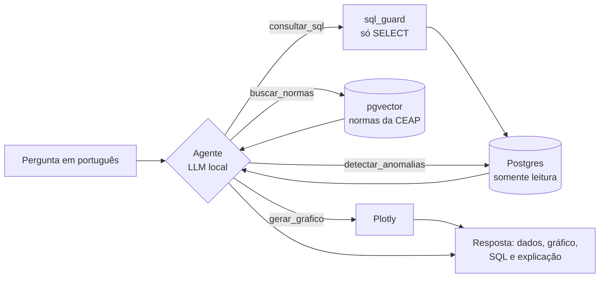

# Pergunte à Câmara

> Um agente de IA que responde perguntas em português sobre os gastos da cota parlamentar
> dos deputados federais. Ele transforma a pergunta em SQL, consulta os **dados abertos oficiais
> da Câmara**, gera o gráfico e explica o resultado, mostrando cada passo do raciocínio.
> Roda **100% local**, sem custo de API.

<!-- TODO: GIF da demo (docs/demo.gif) -->

## Por que este projeto

Os dados de gastos da cota parlamentar são públicos, mas estão em arquivos grandes que pouca
gente consegue analisar. Este projeto permite fazer perguntas em linguagem natural sobre eles.
É uma ferramenta de **transparência**, neutra e baseada só em dados oficiais
([princípios](specs/00-principios.md)).

## Arquitetura



## Destaques técnicos

- **Agente com tool use:** o LLM decide quais ferramentas chamar e corrige o próprio SQL quando
  ele falha.
- **Text-to-SQL seguro:** duas camadas independentes (validação com `sqlglot` + usuário de banco
  somente leitura com timeout).
- **RAG** sobre as normas da cota parlamentar.
- **Detecção de anomalias** estatística, com aviso explícito de que não indica irregularidade.
- **Avaliação:** acurácia de execução do text-to-SQL comparando modelos ([experimentos](experiments/)).
- **Spec-Driven Development:** toda funcionalidade começa em [specs/](specs/).

## Resultados

<!-- TODO: tabela de experiments/README.md -->

## Stack

| Camada | Tecnologia |
|---|---|
| Linguagem | Python 3.11 |
| LLM | Ollama (local) · OpenAI opcional via configuração |
| Banco | PostgreSQL + pgvector |
| Validação de SQL | sqlglot |
| Embeddings | sentence-transformers (multilíngue) |
| API / Demo | FastAPI · Streamlit · Plotly |
| Qualidade | pytest · ruff · GitHub Actions |

## Como rodar

```bash
# 1. Banco
docker compose up -d

# 2. Ambiente Python
python -m venv .venv
source .venv/bin/activate        # Windows: .venv\Scripts\activate
pip install -r requirements.txt
cp .env.example .env

# 3. Carga dos dados abertos (baixa e carrega 2024 e 2025)
python -m src.ingestion

# 4. LLM local (https://ollama.com)
ollama pull qwen2.5:7b

# 5. Testes
pytest

# 6. API e demo
uvicorn src.api.main:app --reload
streamlit run app/streamlit_app.py
```

## Estrutura

```
specs/        especificações (SDD): princípios e funcionalidades
db/           criação do banco, índices e usuário somente leitura
src/
  ingestion/  download e carga dos dados abertos da Câmara
  agent/      laço do agente e prompts
  tools/      ferramentas: SQL (com sql_guard), anomalias, gráficos
  rag/        busca vetorial nas normas
  api/        FastAPI
app/          demo em Streamlit
experiments/  avaliação do text-to-SQL
tests/        testes automatizados
docs/         imagens e GIF da demo
```

## Fonte dos dados

Dados abertos da Câmara dos Deputados. Os dados são exibidos como publicados pela fonte oficial.
Valores fora do padrão estatístico **não indicam irregularidade**.

## Roadmap

Entrega contínua, na ordem do [roadmap completo](specs/ROADMAP.md):

- [x] Ingestão dos dados abertos ([spec](specs/02-ingestao.md)) e `sql_guard`
- [ ] Agente com tool use, autocorreção do SQL, API com streaming e demo
- [ ] Avaliação: acurácia de execução, recusas, injection, comparação de modelos, análise de erros
- [ ] Guardrails de entrada e de saída (grounding) e few-shot dinâmico
- [ ] RAG nas normas da CEAP: busca híbrida, reranking e avaliação
- [ ] Detecção de anomalias e mapa de gastos por UF
- [ ] Memória de conversa
- [ ] Observabilidade com Langfuse e servidor MCP
